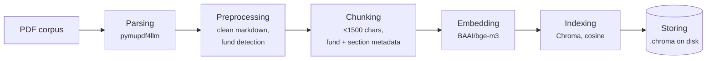
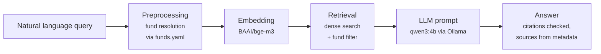

# Take Home Assignment

## Preface
The project runs two models locally, so you'll need a machine that can download and run them
* qwen3:4b (4-bit quantised, ~2.5 GB) generates the answers. It runs through `Ollama`, so `Ollama` has to be installed and running, and the model pulled once with `ollama pull qwen3:4b`.
* BAAI/bge-m3 (~2.2 GB) embeds the document chunks and the questions. It's loaded with `sentence-transformers` and downloaded from Hugging Face automatically the first time you run `rag ingest`. I developed and tested everything on a laptop with an NVIDIA RTX 3060 (6 GB VRAM) under WSL2 (8 GB RAM). Both models fit on that GPU together. They can also run on a cpu, just slower.

## Installation 
Clone the repository
```sh
git clone git@github.com:mtsatsev/rag.git
```
Alternatively download it as `.zip` and unpackage it.

The project has all of its dependencies under the `pyproject.toml` and utilized `uv` as package manager. From the root directory execute
```sh
pip install uv # if not installed
uv sync --all-extras --all-groups  # should not take too much time
```

## Usage
From the root directory run
```sh
source .venv/bin/activate
```

To build the index move the documents into the `src/data` folder and run
```sh
rag ingest
```
This should create an index called `.chroma` in the root of this repository. If you want to change the path of either the index or the documents you can use 
```sh
rag --index /path/to/index ingest --data /path/to/data
```
However, keep in mind that if you provided an index path then you must also pass the same path when you ask questions.

To query use
```sh
rag ask "<your query goes here>"
```
If a different index path is used besides `.chroma` then use

```sh
rag --index /path/to/index ask "<your query goes here>"
```
Alternatively you can run it from a `ipynb` notebook. In VSCode first connect the kernel to the virtual environment of the repository then use

```py
from rag.generate.answer import Answerer
from rag.generate.llm import OllamaClient
from rag.index.embed import BgeM3Embedder
from rag.index.store import ChunkStore
from rag.ingest.funds import load_registry
from rag.ingest.runner import ingest
from rag.retrieve.dense import build_dense_retriever
```

```py
DATA_DIR = "/path/to/documents"
INDEX_DIR = "/path/to/index"
```

```py
# Build or update the index (unchanged PDFs are skipped)
store = ChunkStore(INDEX_DIR, BgeM3Embedder())
registry = load_registry()
print(ingest(DATA_DIR, store, registry))
```

```py
answerer = Answerer(build_dense_retriever(store, registry), OllamaClient())
answer = answerer.answer("Can I transfer my fund units to another person?")
print(answer.model_dump_json(indent=2))
```

### Running the tests
The automatic tests can be ran using
```sh
uv run pytest -vv tests/
```
When running for the first time if the `BAAI/bge-m3` is not installed the test in `tests/index/test_embed.py` will try to download the model in the background and you won't even see the progress bar. Downloading the model takes approximately 15-20 minutes. So if you want to run the rest of the tests use
```sh
uv run pytest -vv tests/ --ignore=tests/index/test_embed.py  
```

## Architecture
The architecture follows these two seams

### Building the index



### Answering a question




## Design decisions

## Project structure
```
rag/
├── config/
│   └── funds.yaml          # umbrellas, sub-funds (aliases, ISINs) and which document belongs to which fund
├── src/
│   ├── data/               # the PDFs go here (not tracked) and questions.yaml for the evaluation
│   └── rag/
│       ├── __main__.py     # the `rag ingest` / `rag ask` command line
│       ├── models.py       # all pydantic models shared across the package
│       ├── ingest/
│       │   ├── parse.py    # PDF -> markdown per page (pymupdf4llm), file hashing
│       │   ├── clean.py    # markdown/HTML clean-up, Latin look-alikes in Cyrillic, match_key
│       │   ├── funds.py    # loads funds.yaml, detects sub-fund sections in the prospectus
│       │   ├── chunk.py    # paragraphs -> chunks with fund, section and page metadata
│       │   └── runner.py   # ingests a folder: adds new, replaces changed, removes deleted documents
│       ├── index/
│       │   ├── embed.py    # bge-m3 embedder
│       │   └── store.py    # Chroma wrapper: replace/delete a document, query with a filter
│       ├── retrieve/
│       │   ├── resolver.py # finds the funds/umbrellas named in a question
│       │   ├── filters.py  # turns them into a metadata filter
│       │   ├── dense.py    # dense retriever (the one used)
│       │   ├── keyword.py  # BM25 index (evaluated, not used)
│       │   ├── hybrid.py   # dense + BM25 with reciprocal rank fusion (evaluated, not used)
│       │   └── protocol.py # the Retriever interface
│       ├── generate/
│       │   ├── prompt.py   # system prompt and source formatting
│       │   ├── llm.py      # Ollama client (qwen3:4b, JSON schema output)
│       │   └── answer.py   # retrieval -> LLM -> citation checks -> answer with sources
│       └── evaluation/
│           ├── chunking.py # chunk statistics: sizes, fund coverage, near-duplicates
│           └── retrieval.py # MRR, hit@k and fund purity for each retriever variant
├── tests/                  # mirrors src/rag; documents.py and fakes.py are shared helpers
├── JustFile                # `just format`, `just test`
└── pyproject.toml
```


### Parsing
Parsing a PDF is one of the most challenging topics in software engineering because the format is genuinely unstructured. There were 2 libraries that were considered for the task [pymupdf4llm](https://pymupdf.readthedocs.io/en/latest/pymupdf4llm/) and [docling](https://docling.ai/). Since all the documents were `.pdf` and had a text layer (so no ocr was needed) I decided to stick with `pymupdf4llm`.

We used the library to parse documents as markdown (both plain text and tables), chunking at pages (so we return a list of parsed pages) without headers, footers and OCR. This was eventually a 1 command function - check `src/ingest/parse.py`

### Cleaning and multilingual handling
The markdown coming out of `pymupdf4llm` has some noise that doesn't help retrieval, so every page goes through a small cleaning step before chunking. 
* It removes the picture markers if any are found. 
* It removes `<br>` and `<u>` tags, bold and italic markers
* Collapses extra spaces and blank lines. 

Headings and tables stay as markdown because the chunker uses them later. Again this is a single function - check `src/rag/ingest/clean.py`.

The Bulgarian documents had one less obvious problem. Some words written in Cyrillic contained Latin letters that look exactly the same such as `A`, `O`, `P`, `C`, `e`. This difference is invisible to us humans when reading but for computers they are effectively different numbers. And with these the embedding model would treat visibly the same words as 2 different tokens and in embedding space they won't match. The cleaning step finds words that contain at least one Cyrillic letter and replaces the Latin look-alikes in them with their Cyrillic version. English words are left untouched.

We can see for each pdf, how many mixed words there are
```python
CYRILLIC = re.compile(r"[Ѐ-ӿ]")
LATIN = re.compile(r"[A-Za-z]")

documents = [parse_pdf(DATA_DIR / file_name) for file_name in registry.documents]

for document in documents:
    text = "\n".join(page.markdown for page in document.pages)
    mixed = Counter(w for w in re.findall(r"\w+", text) if CYRILLIC.search(w) and LATIN.search(w))
    print(mixed)
```
> FU_BF065_EN.pdf Counter()\
> KID_BE6316179249_BG.pdf Counter({'дистрибуторa': 1, 'Tози': 1, 'бъдещoто': 1, 'Mакс': 1})\
> 17126.pdf Counter({'ангажиранe': 2})\
> 18325.pdf Counter({'ангажиранe': 4})\
> 18368.pdf Counter({'eвро': 1})\
> 11074.pdf Counter()

 
A real word almost never mixes the 2 alphabets so everything it returned was treated as corrupted and cleaned. It found cases in all 4 Bulgarian fund documents. For example `Този` (Latin `T`), `Макс` (Latin `M`) and `дистрибутора` (Latin `a`) in the KID (all light up pylint if they are copied as string). These and more real examples are also the test cases in `tests/ingest/test_clean.py`.

On top of that there is a `match_key` function, which also removes punctuation and lowercases the text. It is used whenever 2 pieces of text have to be compared exactly, for example `"someThing"` and `"something"` should match. It is used for finding fund names in the question, the keyword (BM25) search and checking that the quotes the LLM returns actually appear in the source. It is not used for the embeddings. The chunks are embedded with their original casing and without any transliteration, since `bge-m3` is multilingual and handles that by itself. This is also what makes a question in English find a Bulgarian document and the other way around.

Finally, the LLM is told to answer in the language of the question, regardless of the language of the sources. If a question has both Bulgarian and English part then it is for the LLM to decide what would be the **entity** (in what language specifically) and what is the actual question and answer in its language. A mixed queries like "What e най-добрия choice...." were not tested as they seem unrealistic.

### Chunking
The chunker works on paragraphs, not on a fixed number of characters. After cleaning, each page is split on blank lines, so a paragraph is a block of text, a heading or a whole table. While walking through the paragraphs we keep track of the current headings, so every paragraph knows its page, the section it belongs to, for example `Information concerning the sub-fund X > 1. Basic details`, and its fund.

Paragraphs are then packed together into chunks of up to 1500 characters. There are a few rules on top of that:
* A `#` or `##` heading always starts a new chunk, so 2 different top level sections never end up in the same chunk.
* A change of fund always starts a new chunk. This matters for the prospectus where one document describes 30+ sub-funds, and a chunk with text from 2 of them would be impossible to retrieve correctly.
* A chunk never ends with a heading. If a heading is the last thing that fits, it is moved to the next chunk together with the text it belongs to.
* A paragraph longer than 1500 characters is split by lines, and a line that is still too long is split at the end of a sentence. Tables are only split between rows and the table header is repeated in every piece, so a piece of a table still says what its columns mean.

Every chunk gets its section (the headings shared by its paragraphs), its first and last page, the document and the fund. These are what the sources in the answer are built from later. The chunk id is a hash of the file hash and the chunk position, so re-ingesting the same file gives the same ids. Again it's a single function - check `src/rag/ingest/chunk.py`.

Why 1500 characters? It is roughly 300-500 tokens, which is enough to hold a full answer like a fee table or a redemption rule, and small enough that 5 chunks plus the prompt fit into the 8192 tokens context of `qwen3:4b` (I actually use 4096 because of memory issues). It is also well under the 1024 tokens limit I set for `bge-m3` (again memory constraints), so nothing gets cut when embedding.

There is no overlap between chunks. Since the chunks follow the structure of the document. A chunk usually starts at a heading or at the beginning of a paragraph so there is little to no context lost at the boundaries. Overlap would also duplicate text, and the prospectus is already very repetitive. In fact a great deal of the chunks are highly repetitive among each other (the chunk similarity rate is 0.7622377622377622
)

Overlap was actually not tested entirely so my previous comment is pure speculation.


### Keeping funds apart
The funds were given as part of the assignment, so instead of extracting them from the documents I listed them in `config/funds.yaml`, together with their umbrella, ISIN, aliases and which document belongs to which fund. It was a nice workaround to get the fund of every chunk at minimal computational cost. The only document that needs more is the prospectus, since it describes many sub-funds. There the fund is detected from the `Information concerning the sub-fund ...` and `Annex for ...` headings while chunking. This approach may not easily apply to further documents. If they are long, then we assume that they are parsable in tghe same way as the prospectures. If they are small, then funds can be added by hand (or with LLM), otherwise that is a room left for improvement.

At query time the funds named in the question are looked up in the same file and used as a filter such that only chunks of those funds plus the general umbrella are retrieved.

### Embeddings and vector store
The chunks are embedded with `BAAI/bge-m3`, because it is multilingual and puts Bulgarian and English text with the same meaning close to each other. Before embedding, the fund and section are added at the top of the chunk text (`fund | section`), so a chunk that doesn't mention its fund still ends up near questions about that fund.

We implemented the vector store using Chroma DB to leverage its metadata filtering, which is what the fund filter relies on. It runs locally, saves the index to disk (`.chroma`) and uses cosine similarity. Each chunk is stored with its metadata (document, fund, umbrella, section, pages and the file hash), which also makes it easy to replace or delete all chunks of one document when it changes.

To facilitate replacement, adding new or deleting a document, we provided functions such as:
* `replace_document` - replaces all the chunks of the replaced document
* `delete_document` - deletes all the chunks of the deleted document

Running the ingest command on the same document corpus with no change (tracked by the hash) results in nothing. So modifying a document, adding a document would be as easy as moddifying and or adding a document to the data folder and running the command.


For implementation details check `src/rag/index/store.py`.

### Retrieval
Before searching, the question goes through a small resolver that finds the fund or umbrella names in it (using the names and aliases from `funds.yaml`) and turns them into a filter. All retrievers below use the same filter.

We implemented 2 retrievers:
* **Keyword (BM25)** - classic keyword matching over the chunk text, using the `match_key` version of the words. Good for exact terms like ISINs or fee names, but it only works when the question and the document use the same words in the same language.
* **Dense (vector search)** - the question is embedded with `bge-m3`(sama model as during indexing) and the closest chunks are taken from Chroma. This works across languages, so an English question can find a Bulgarian chunk.

We also tried a **hybrid** of the 2, which combines both rankings with reciprocal rank fusion. It turned out worse than dense alone, mostly because BM25 is weak on the cross-lingual questions and pulls the good dense results down (see the Evaluation section). So the system uses dense retrieval with the fund filter.

There is no reranker. Dense retrieval already finds a correct source in the top 5 for 93% of the questions (the questions were LLM crafted see `src/data/questions.yaml`), and a reranker would be a third model that has to find a plance on the 6 GB of GPU memory. For a bigger collection and or more retrieved results it would be the first thing to try.

### Answer generation
The answers are generated by `qwen3:4b`, a small open source model that runs locally through Ollama. It gets a custom role prompt and a set of instructions: answer only from the given sources, never mix funds, cite every claim with a short verbatim quote, say when the answer is not there or the question is ambiguous, and answer in the language of the question. The retrieved chunks are passed as numbered sources (`[S1]`, `[S2]`) so the model only has to return a short label instead of a file name and page. The output is forced into a fixed JSON schema built from a pydantic model, which Ollama enforces during generation - check `src/rag/generate/prompt.py`.

The model's answer is not trusted as is. If no retrieved chunk scores above a minimum similarity (0.35), we return `"not found"` without even calling the LLM. Every quote the model returns is checked against the source it cites and an answer without a single valid citation is turned into `"not found"`. The sources and funds in the final answer are taken from the metadata of the cited chunks not from the LLM so a document name or page can't be made up - check `src/rag/generate/answer.py`.

## Evaluation

### Chunking
There is no ground truth for chunks, so instead I checked that the chunker does what it is supposed to do and looked for anything suspicious. All of it is in `src/rag/evaluation/chunking.py` and the results are in `src/notebooks/explore.ipynb`. The 6 documents gave 1573 chunks.

* **Length.** Most chunks are between 1000 and 1500 characters, with a peak just below the limit, so the packing fills chunks well. Only 4 chunks are shorter than 200 characters (the last bit of a section or a short document) and 2 chunks in the prospectus go slightly over 1500 (max 1566), because a heading was carried over from the previous chunk.
* **Coverage.** Every page of every document ends up in at least one chunk, so nothing is lost between parsing and chunking. All chunks of the single fund documents have a fund. The investor rights document has none, which is correct because it applies to all funds. In the prospectus 96% of the chunks have a fund, and the rest are the 64 chunks of the general umbrella pages (1-24), which is also correct. Almost all chunks have a section.
* **Fund breakdown.** Each sub-fund of the prospectus gets around 30 chunks over one continuous page range, e.g. `K&H egészség` pages 38-50 and `K&H egészség 2` pages 50-62. A sub-fund appearing on random pages would mean the fund detection is broken, and that didn't happen.
* **Near-duplicates.** I compared all chunks with TF-IDF and counted the chunks that have an almost identical chunk (similarity ≥ 0.9) belonging to a different fund. This is the case for 76% of the chunks. The prospectus repeats the same text for every sub-fund, often word for word (e.g. the tables with the shares in a basket). This is the most important finding of the chunking evaluation: from the text alone the funds can't be told apart, so the fund has to come from the metadata and be used as a filter.
* **UMAP plot.** The 2D map of the TF-IDF vectors shows the same thing. The chunks form many small, tight islands, and each island is one boilerplate section repeated across many sub-funds, not one fund. The Bulgarian documents sit together in their own area, since TF-IDF only matches words of the same language.

### Retrieval
For the retrieval an LLM created a set of 33 questions using the example ones as a starting point and going into edge cases. The generation also included the document and pages where the answer is (`src/data/questions.yaml`). 28 of them are answerable and 5 are not, either because the information is not in the documents or because they ask about a fund we don't have. They cover single fund questions, cross-lingual ones, questions with an ISIN, questions about the umbrella and so on. A retrieved chunk counts as relevant if it is from the right document and overlaps the expected pages.

The metrics are:
* **MRR** - 1 / the rank of the first relevant chunk, averaged over the questions
* **hit@k** - share of questions with at least one relevant chunk in the top k
* **purity@10** - share of the top 10 chunks that belong to the asked fund

Each retriever was run with and without the fund filter - check `src/notebooks/evaluate_retriever.ipynb`.

| Retriever | Filter | MRR | hit@1 | hit@5 | purity@10 |
|---|---|---|---|---|---|
| Dense | no | 0.72 | 0.61 | 0.89 | 0.76 |
| Keyword (BM25) | no | 0.35 | 0.25 | 0.46 | 0.78 |
| Dense | yes | **0.76** | **0.64** | **0.93** | **1.00** |
| Keyword (BM25) | yes | 0.39 | 0.29 | 0.54 | 1.00 |
| Hybrid | yes | 0.69 | 0.61 | 0.75 | 1.00 |

What it shows:
* Dense is much better than BM25 on every metric. 7 of the questions are cross-lingual, and there BM25 has no words to match.
* The fund filter makes every retriever better and brings the purity to 100%. Without it about a quarter of the top 10 chunks come from the wrong fund, which is exactly the near-duplicate problem from the chunking evaluation.
* Hybrid is worse than dense alone. Combining the rankings with equal weights lets the weak BM25 results push good dense results out of the top 5. Potentially for a future improvement a play with weights for the 2 retrievers might bring about positive results.

So the system uses dense retrieval with the fund filter. The question set is small and the labels were generated with an LLM (and checked against the chunks), so the numbers show which retriever is better rather than how good it is exactly (as we can see a hit@1 of 64% is not exactly _"amazing"_).

### Answers
The answers were not evaluated automatically. I checked them manually on the example questions from the assignment, 3 about ОББ ЕкспертИйз Дефанзивен Консервативен Отговорно Инвестиращ and 2 about the rights of investors. For each one I checked that the answer is correct, that the cited sources are the right document and page, and that the fund is the right one.

## Limitations and known failure modes
* **The best chunk is often not the right one.** hit@1 is only 64%, so for 36% of the questions the top ranked chunk is not the one with the answer. The LLM gets the top 5 chunks, and there a relevant chunk is found 93% of the time, so most answers are still fine. But for the remaining 7% the answer is not in the context at all and the best the system can do is say "not found". This could be improved with a reranker on top of the dense results, a different chunking strategy (smaller chunks or some overlap) or by rewriting the question before searching.
* **The system is not thoroughly tested.** The retrieval was evaluated on 33 questions and the answers were only checked manually on the example questions from the assignment. Questions that mix Bulgarian and English in one sentence were not tested at all. I assume real users write in one language, but if they don't, the fund resolver and the answer language could go wrong.
* **The score threshold is not calibrated.** The 0.35 minimum similarity, below which the system says "not found" without asking the LLM, was chosen by hand. Too high and good questions get rejected, too low and the LLM gets irrelevant chunks.
* **Funds have to be listed by hand.** A new fund or document has to be added to `funds.yaml` first, otherwise ingestion stops with an error.
* **Small LLM.** `qwen3:4b` follows the instructions well most of the time, but it can still misread a table or give a vague answer. The citation check catches made up quotes, not wrong conclusions from correct quotes.

## Production considerations

### A much larger document collection
For thousands of documents the local Chroma would be replaced by a vector database server, ingestion would run in batches in the background, and `funds.yaml` would become a fund catalogue (a database or an internal API) instead of a hand-written file. With many more similar chunks a reranker and a bigger LLM would also be worth their cost.

### New and updated document versions
Changed files are already detected by their hash and their old chunks are replaced, so an updated document never mixes with its previous version. In production I would also keep the old versions with a validity date, so the system can answer "what was the fee in 2024", and re-run the evaluation every time the documents change.

## How this was built
The repository was build using a coding asisstant constrained by a relaxed test driven development methodology. In a nuteshell the flow is:
* A test suite is introduced with expected input and output. The suite is both human and LLM generated (for example when inventing dummy `pymupdf` classes).
* The tests follow a strict naming pattern `test_<what>_<when>..._<then>_...`. A developer should be able to read the names of the tests and understand what this test and by extension test suite is designed to test.
* With the tests written the LLM coding assistant is responsible to create the most minimal behavior implementation to satisfy these tests. 
* The implementation is reviewed and where possible refactored. This means that I have read the code, however, not in 100% detail. A question of the sort "here you append the paragraph at -1. What will happen if I add it at 0" would require time to be answered if it isn't an obvious error.
* Models are designed before any behavioral implementation begins and are used as further constraint blocks (during implementation the LLM should not modify them but only flag limitations that it met with them, then I can either relax it or ignore it).
